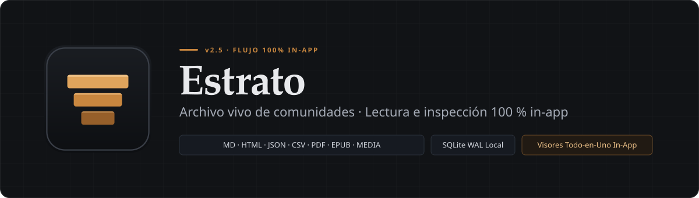
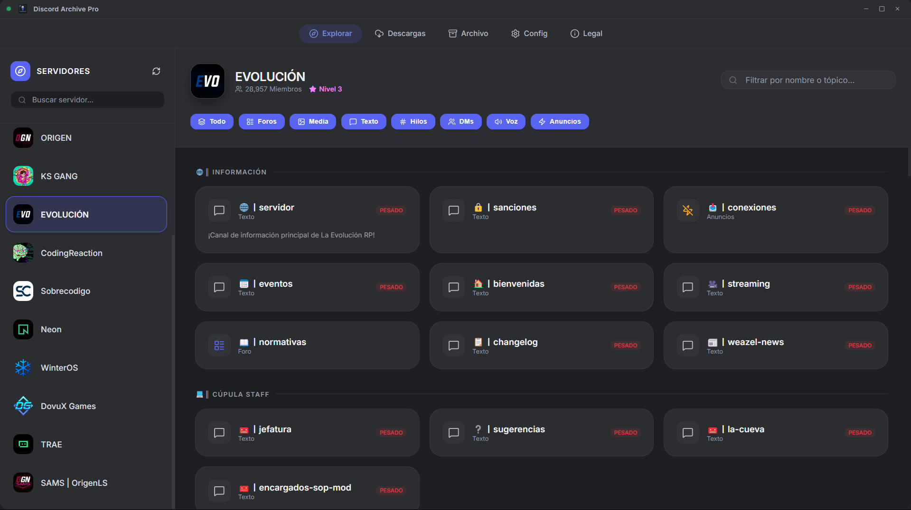
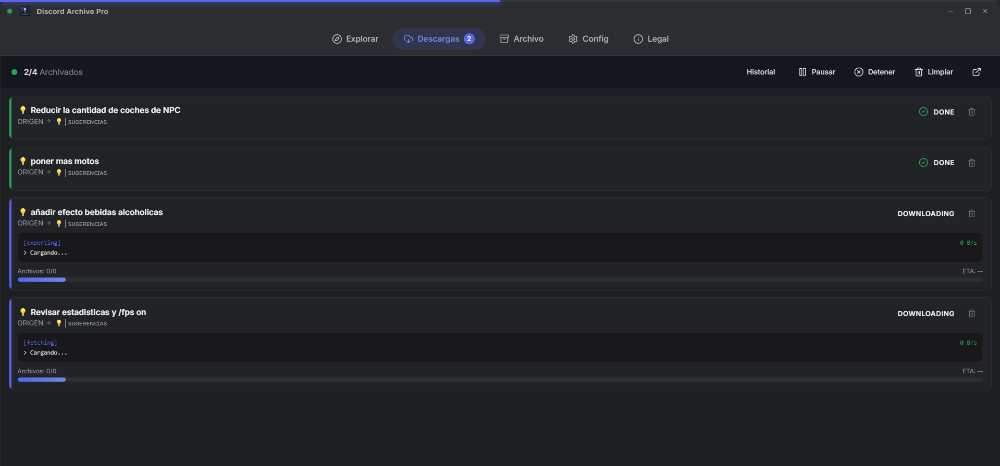
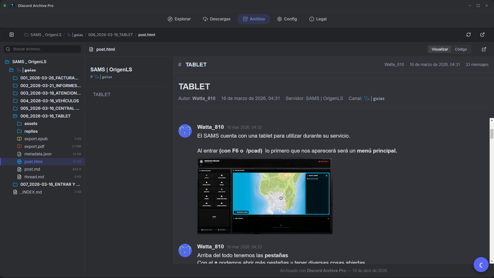

<p align="center"></p>

<p align="center">
  
  
  
  
</p>

**Estrato** (*archivo vivo de comunidades*) preserva canales, hilos y adjuntos de Discord directamente en tu propio disco en formatos duraderos y legibles sin conexión, sin depender de servidores propios ni suscripciones en la nube.

---

## Por qué existe Estrato

Las comunidades de Discord acumulan guías técnicas, debates de diseño, incidencias resueltas y archivos valiosos dentro de un servicio cerrado que dificulta la consulta a largo plazo o fuera de línea. **Estrato** resuelve dos necesidades en una misma aplicación de escritorio:

- **Preservación real en tu disco:** descarga conversaciones, metadatos, reacciones y adjuntos con deduplicación SHA-256 y rutas relativas portables para que puedas mover o copiar tu archivo dentro de veinte años y todo siga abriendo.
- **Flujo y lectura 100 % in-app sin depender de ventanas externas:** explora canales en vivo, filtra mensajes antes de descargar y, al terminar la cola, abre automáticamente el resultado en su visor integrado todo-en-uno (`Markdown`, `HTML`, `JSON`, `CSV`, `PDF`, `EPUB`, código fuente en >25 lenguajes, vista dual `SVG`, ficha técnica de binarios, galería multimedia y modo **Explorador de archivos** raíz).

Funciona **en modo solo lectura** utilizando tu token personal contra la API oficial de Discord: descarga únicamente lo que tu cuenta ya puede ver y nunca envía mensajes, reacciona ni modifica el servidor.

> **Aviso importante.** Automatizar una cuenta de usuario contra la API puede contravenir los [Términos de Servicio de Discord](https://discord.com/terms). Estrato es un proyecto independiente, sin afiliación ni respaldo de Discord Inc.; la responsabilidad de uso recae sobre quien ejecuta la aplicación.

---

## Galería de la interfaz

| Explorar (tres paneles y lectura en vivo) | Cola de descargas e historial | Visor integrado de archivos |
| :---: | :---: | :---: |
|  |  |  |

---

## Seis formatos de exportación y visor todo-en-uno

Cada publicación o canal archivado puede exportarse simultáneamente en hasta **seis formatos** (más un índice `_INDEX.md` por carpeta) y abrirse automáticamente al concluir la cola de descargas o mediante el salto directo **«Abrir en el visor integrado»** desde **Panel**, **Cola** (*«Abrir última en visor»*), **Historial**, las notificaciones toast interactivas, la paleta de comandos (`Ctrl+K` → *Archivo reciente*), la búsqueda global (`Ctrl+F`) o el propio explorador (**Explorar**, **Chat de canal** y **Visor de hilo en vivo** cuando ya figura como **En archivo**):

| Formato | Archivo generado | Capacidades de exportación | Experiencia en el visor integrado |
|---|---|---|---|
| **Markdown** | `post.md`, `thread.md`, `replies/` | Frontmatter YAML, etiquetas por nombre, modo hilo (`single`, `separate`, `both`) y enlaces relativos | Render tipográfico (`react-markdown` + `remark-gfm`), buscador interno con resaltado (`<mark>`), filtro de bloques coincidentes, selector de ancho (`78ch` / `110ch` / `100 %`) y fuente (`Sans` / `Serif` / `Mono`), selector directo de `replies/*.md`, índice H1–H3 y zoom |
| **HTML** | `post.html` | Documento autocontenido con CSS embebido y conmutador de tema claro/oscuro sin JavaScript | Pestaña con conmutador **Vista HTML** (aislado en `<iframe sandbox="">`) y **Código fuente** copiable |
| **JSON** | `post.json` | Estructura completa del hilo, autores, adjuntos, embeds y reacciones (con respaldo compacto para hilos enormes) | Conmutador **Vista tarjetas** (tarjetas legibles por mensaje con autor, fecha, adjuntos y reacciones filtrables) y **Código JSON**, con barra de resumen automático |
| **CSV** | `messages.csv` y `post.csv` | Codificación UTF-8 con BOM, saltos CRLF, RFC 4180 y neutralización anti-fórmulas (`sanitizeCsvFormula`) | **Tabla CSV interactiva**: búsqueda en vivo, ordenación por columna, paginación de 100 filas, botón **Copiar vista filtrada (N)** en RFC 4180 y conmutador a código |
| **PDF** | `export.pdf` | A4 paginado con fuente Unicode `Roboto-Regular.ttf` embebida (`@pdf-lib/fontkit`) e imágenes vía `sharp` | Previsualización nativa embebida dentro del visor (`.visor__frame`) |
| **EPUB** | `export.epub` | Capítulos XHTML escapados por lotes de 250 mensajes, 100 % offline y sin imágenes remotas | Lector de libros integrado (`epubjs`) con paginación, **sincronización automática con el tema activo** (`Oscuro`, `Claro`, `Sepia`) y escala de fuente (50 %–200 %) |
| **Multimedia, Código y Binarios** | `assets/images/`, `videos/`, `files/` | Descarga concurrente por streaming con verificación y deduplicación SHA-256 por publicación | **Galería multimedia** filtrable (*Todos*, *Imágenes*, *Vídeos*, *Audio*), **visor de código** (>25 lenguajes con filtro de líneas y ajuste de línea), **vista dual SVG** (*Vista imagen* / *Código SVG*) y **ficha técnica de binarios** |

Además, en la raíz de **Archivo** puedes alternar entre **Colecciones (N)** y el modo **Explorador de archivos** para recorrer el árbol completo de `outputDir` e inspeccionar cualquier carpeta o archivo descargado aunque no forme parte de una colección. Dentro de una colección abierta puedes cambiar entre *Documento*, *Galería* y *Archivos* con `Alt + 1 / 2 / 3`, alternar entre todos los formatos generados desde `.visor__formatos`, recorrer `replies/*.md` y saltar a la colección **Anterior** o **Siguiente** con `Alt + ←` / `Alt + →`.

---

## Exploración en vivo, búsqueda avanzada y atajos

### Lectura, puente con el archivo local y filtrado antes de descargar

- **Tres paneles persistentes en Explorar**: riel de servidores (`Ctrl+Shift+S` abre el selector con buscador), barra lateral de canales con filtro por tipo y lista de publicaciones o chat completo en vivo (`ChannelChatView` y cajón lateral `LiveThreadView`).
- **Puente directo en toda la app ↔ Visor integrado**:
  - `PostList` consulta la caché local (`cache:get-cached-posts`) del canal seleccionado, muestra la insignia **En archivo** en los hilos ya descargados, incorpora el chip de filtro rápido **En archivo** y añade un botón de 1 clic (*«Abrir copia local en el visor integrado»*) para saltar directo al visor.
  - `ChannelChatView` y `LiveThreadView` comprueban si el canal o hilo ya está archivado (`cache:check-post`), muestran la insignia **En archivo** y ofrecen el botón **Abrir en visor** en la cabecera.
  - `DashboardView` permite filtrar **Archivo** por servidor haciendo clic en cualquier fila de *«Servidores con más peso»* (`uiStore.abrirArchivoServidor`), e incorpora buscador rápido en *«Actividad reciente»* con títulos clicables hacia el visor integrado.
- **Operadores de filtro en el lector en vivo** (insensibles a tildes y mayúsculas, junto con el texto libre y nombres de archivo):
  - `from:usuario` / `de:usuario` (admite comillas para nombres con espacios, p. ej. `de:"Ana Pérez"`).
  - `has:embed` — mensajes con embeds enriquecidos.
  - `has:pinned` o `pinned:true` — mensajes fijados.
  - Chips rápidos en barra: **Adjuntos**, **Enlaces** y **Fijados**, además de copia directa de la transcripción visible en formato Markdown.
- **Lista de publicaciones de foro (`PostList`)**: chips rápidos (**Todos**, **Con adjuntos**, **Fijados**, **Archivados**, **En archivo**), ordenación, agrupación por etiquetas, selección múltiple por rango con `Shift + Clic`, inversión y copia de lista.

### Búsqueda global en disco (`Ctrl+F`) extendida a `assets/` y propagación al visor

Recorre tus carpetas exportadas —incluyendo archivos de texto, código, configuración, SQL, logs, JSON y CSV descargados dentro de `assets/` (`.md`, `.txt`, `.html`, `.htm`, `.json`, `.csv`, `.log`, `.xml`, `.yml`, `.yaml`, `.sql`, `.css`, `.js`, `.ts`, `.py`, `.sh`, `.ini`, `.toml`)— sin depender de índices externos: soporta coincidencia insensible a tildes, chips de extensión (`ext:md`, `ext:html`, `ext:json`, `ext:csv`, `ext:txt`), historial de búsquedas recientes y resaltado contextual. Al pulsar cualquier resultado (*«Abrir y resaltar en el visor»*), Estrato abre el archivo y **propaga automáticamente el término buscado** al buscador interno de `VisorDocumento`, `VistaCsv`, `VistaJson` o `VistaCodigo`.

### Atajos de teclado principales

| Combinación | Acción |
|---|---|
| `Ctrl + K` | Abrir paleta de comandos (vistas, **Archivo reciente**, servidores, canales, temas y optimización) |
| `Ctrl + F` | Abrir búsqueda global en el archivo local (propaga el término al visor al abrir un resultado) |
| `Ctrl + /` | Abrir hoja completa de atajos (con buscador instantáneo de atajos) |
| `Ctrl + 1` … `Ctrl + 6` | Ir a **Panel**, **Explorar**, **Cola**, **Archivo**, **Ajustes** o **Legal** |
| `Ctrl + Shift + S` | Abrir o cerrar el selector de servidores (en *Explorar*) |
| `Ctrl + Shift + M` | Compactar o expandir la ventana |
| `Ctrl + Shift + F` | Mostrar u ocultar la ventana desde el sistema |
| `Alt + ←` / `Alt + →` | Ir a la colección **Anterior** o **Siguiente** dentro del visor de **Archivo** |
| `Alt + 1` / `Alt + 2` / `Alt + 3` | Cambiar entre las pestañas **Documento**, **Galería** y **Archivos** dentro de una colección |
| `Esc` | Cerrar la capa superior activa (visor multimedia, paleta, búsqueda, atajos, hilo o canal) |
| `Shift + Clic` | Seleccionar rango de publicaciones en *Explorar* |
| `←` / `→` · `R` · `+` `-` `0` · `Doble clic` | Navegar, rotar 90°, ajustar zoom o alternar 100 % / 200 % en el visor multimedia |

---

## Identidad visual y tres temas editoriales

Estrato incorpora una tipografía del sistema **100 % offline** (sin fuentes externas ni peticiones CDN) y tres temas completos sincronizados en toda la aplicación —desde el botón rotatorio del riel lateral, **Ajustes → General** o `Ctrl+K`:

- **Tinta oscura** (`dark`): fondo cálido oscuro con acento cobre (`#c9873f`) para sesiones nocturnas.
- **Papel claro** (`light`): paleta crema cálida de alto contraste para lectura diurna.
- **Pergamino sepia** (`sepia`): tono cálido diseñado específicamente para lectura prolongada de hilos extensos, Markdown y CSV.

---

## Rendimiento, cola y salud del archivo

- **Cola con prioridades e historial**: gestiona descargas concurrentes configurables (1–10), pausa y reanudación, reintento masivo de fallidas, búsqueda sobre el historial y exportación del historial filtrado en CSV (`Copiar CSV`).
- **Métricas en vivo del motor**: **Panel** y **Ajustes → Sistema** muestran consumo real de RAM RSS, heap V8, porcentaje de CPU, ocupación de cachés LRU y tamaño de `estrato.db` y su registro WAL.
- **Optimización manual de RAM y WAL**: un clic en **Optimizar RAM** / **Optimizar ahora** limpia las cachés LRU en memoria, poda tareas ya terminadas y compacta SQLite (`PRAGMA wal_checkpoint(PASSIVE)` + `PRAGMA shrink_memory`).
- **Verificador de integridad local**: disponible en **Ajustes → Sistema** y desde `Ctrl+K`; comprueba la salud de SQLite (`PRAGMA quick_check`) y detecta archivos movidos o borrados en disco sin sobrescribir exportaciones válidas.

---

## Seguridad por defecto

Todos los detalles del modelo de amenaza viven en [SECURITY.md](SECURITY.md) y [docs/SEGURIDAD.md](docs/SEGURIDAD.md). Controles activos en producción:

- **Aislamiento estricto en Electron (auditado en CI)**: `contextIsolation: true`, `nodeIntegration: false`, `sandbox: true`, `webSecurity: true`, cero permisos web y navegación externa bloqueada, verificados estáticamente mediante `validateElectronSecurityConfig` en `scripts/verify-release.mjs`.
- **Protocolo `archive://` y lectura asíncrona confinados frente a symlinks**: `isInsideReal` e `isInsideRealAsync` (`src/main/path-guard.ts`) resuelven rutas reales (`realpath`) contra tu carpeta de salida en `archive://` y `archive:read-file`; cualquier intento de escape —incluidos enlaces simbólicos hacia el exterior— devuelve `403`.
- **Visor local sin ejecución de código**: HTML archivado dentro de `<iframe sandbox="">` con CSP estricta, JSON analizado como texto puro y exportación CSV protegida con `sanitizeCsvFormula`.
- **Token cifrado localmente**: guardado en `data/preferences.json` mediante `safeStorage` (DPAPI ligado a tu usuario en Windows bajo prefijo `dpapi:`). El renderer nunca recibe ni almacena el token.
- **Red acotada y cero telemetría**: sin analíticas ni servidor propio; `app:open-external` solo acepta `discord:` y destinos `https:` en lista blanca (Discord y reproductores embebidos YouTube/Vimeo).

---

## Instalación, desarrollo y empaquetado

### Requisitos y arranque local

```bash
npm install      # Instala dependencias y recompila módulos nativos para Electron
npm run dev      # Inicia Electron + Vite en modo desarrollo
```

> **Nota sobre módulos nativos y entorno.** `npm install` ejecuta `electron-builder install-app-deps` para ajustar `better-sqlite3` y `sharp` al ABI de Electron 34. Si tu shell define `ELECTRON_RUN_AS_NODE=1`, elimínala antes de lanzar `electron.exe` directamente (consulta la guía completa en [CONTRIBUTING.md](CONTRIBUTING.md)).

### Comandos de calidad y empaquetado

```bash
npm run typecheck           # Comprueba TypeScript en tsconfig.node.json y tsconfig.web.json
npm test                    # Ejecuta las 26 suites unitarias con Vitest (src/ y scripts/)
npm run build               # Compila main, preload y renderer en out/
npm run verify:release      # Audita package.json, invariantes Electron (validateElectronSecurityConfig), iconos PNG/ICO/SVG (validateSvgContent), fuente PDF, docs y workflows
npm run package             # Genera ejecutable portátil dist/Estrato.exe (+ dist/win-unpacked/)
npm run package:installer   # Genera instalador Windows NSIS dist/Estrato-Setup-2.5.0.exe
node scripts/verify-release.mjs --dist   # Audita artefactos en dist/ y genera dist/SHA256SUMS.txt
```

### Primer arranque

1. **Detección automática:** pulsa *Detectar sesión* para localizar el almacén local de Discord o navegadores compatibles y validar el token frente a `/users/@me` con diagnóstico explícito por fuente.
2. **Token manual:** desde Discord web (`F12` → *Application* → *Local Storage* → `https://discord.com` → clave `token`) si tu navegador usa cifrado ligado a la aplicación (`v20`).

---

## Estructura de salida y datos locales

```text
<carpeta de salida>/
└── Mi Servidor/
    └── general/
        ├── _INDEX.md
        ├── 001_2026-01-02_Cómo empezar/
        │   ├── post.md
        │   ├── thread.md
        │   ├── replies/
        │   │   ├── 001_alice.md
        │   │   └── 002_bob.md
        │   ├── post.html
        │   ├── post.json
        │   ├── post.csv
        │   ├── messages.csv
        │   ├── export.pdf
        │   ├── export.epub
        │   └── assets/
        │       ├── images/
        │       ├── videos/
        │       └── files/
        └── 002_2026-01-05_Proyecto/
```

- **Datos internos (`data/`):** `estrato.db` (SQLite WAL) y `preferences.json` viven junto al ejecutable (en el binario portátil se resuelven en `PORTABLE_EXECUTABLE_DIR/data` para persistir entre ejecuciones).
- **Portabilidad total:** todas las referencias dentro de los documentos exportados son relativas.

---

## Limitaciones conocidas

- El limitador de Discord es deliberadamente conservador (~2 peticiones/s) para proteger tu cuenta frente a bloqueos; canales con decenas de miles de mensajes requieren tiempo.
- El exportador PDF incrusta imágenes de adjuntos y texto Unicode con `Roboto-Regular.ttf`, pero no renderiza tablas complejas ni emojis a color como mapa de bits.
- El exportador EPUB omite imágenes remotas por diseño para mantenerse 100 % autocontenido sin conexión.
- La búsqueda global (`Ctrl+F`) escanea archivos reales dentro de topes de seguridad (4 000 archivos y 2 MB por archivo; el visor tabular CSV muestra hasta 5 000 filas por archivo).
- La autodetección no descifra sesiones protegidas con *App-Bound Encryption* (`v20`) en Chromium; en ese caso te orientará para pegar el token manualmente.

---

## Mapa de documentación

| Documento | Contenido |
|---|---|
| [docs/ARQUITECTURA.md](docs/ARQUITECTURA.md) | Capas main/preload/renderer, contrato IPC en `src/shared/api.ts`, exportadores y flujo in-app (`abrirArchivo`, `abrirArchivoServidor`, modo `Explorador de archivos`) |
| [docs/SEGURIDAD.md](docs/SEGURIDAD.md) | Modelo de amenaza, `path-guard.ts` (`realpath`), CSP, `<iframe sandbox="">`, CSV seguro, auditoría SVG/Electron y lista blanca |
| [docs/DISENO.md](docs/DISENO.md) | Marca e isotipos SVG, triple tema (`dark`, `light`, `sepia`), tokens CSS y anatomía de los visores v2.5 |
| [docs/DESARROLLO.md](docs/DESARROLLO.md) | Guía técnica, 26 suites Vitest, scripts CDP, CI/CD en `.github/` y empaquetado |
| [SECURITY.md](SECURITY.md) | Política de seguridad, versiones con soporte (`2.5.x`) y reporte responsable |
| [CONTRIBUTING.md](CONTRIBUTING.md) | Preparación del entorno, convenciones obligatorias y lista previa a un PR |
| [CHANGELOG.md](CHANGELOG.md) | Historial completo de cambios desde la versión `1.0.0` hasta `2.5.0` |
| [LICENSE](LICENSE) | Licencia de uso personal del software (español e inglés) |

---

## Licencia

Estrato se distribuye bajo licencia propietaria para **uso personal** (redistribución y venta no permitidas). Consulta el texto íntegro en [LICENSE](LICENSE) y dentro de la propia aplicación en la vista **Legal** (`Ctrl+6`).
