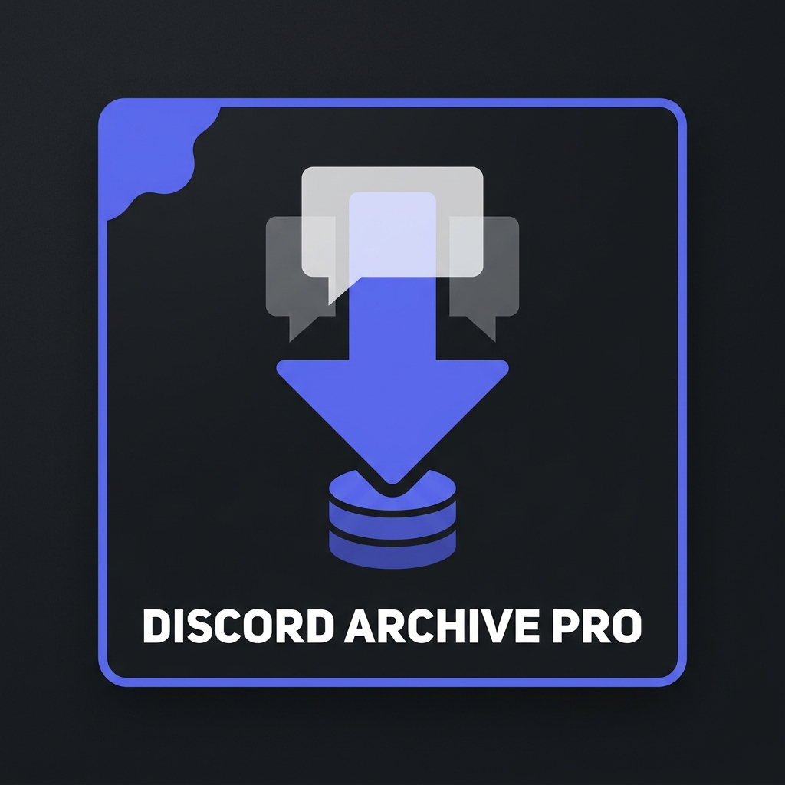

<div align="center">



# Discord Archive Pro

**A professional, open-source desktop application for archiving and exporting Discord servers, channels, forums, and direct messages.**

[](https://www.electronjs.org/)
[](https://www.typescriptlang.org/)
[](https://reactjs.org/)
[](https://www.sqlite.org/)
[](LICENSE)

</div>

---

## Getting Started Guide

### Prerequisites
- [Node.js](https://nodejs.org/) (Version 18 or higher recommended)
- npm or yarn

### Installation and Development
1. Clone or download the repository.
2. Install dependencies:
   ```bash
   npm install
   ```
3. Run in development mode (Hot Reload):
   ```bash
   npx electron-vite dev
   ```

### Packaging and Production
To generate a portable executable for Windows (.exe):
1. Build the source files:
   ```bash
   npx electron-vite build
   ```
2. Package the application:
   ```bash
   npx electron-builder --win portable
   ```
The executable will be generated in the `dist/` directory.

---

## Overview

Discord Archive Pro is a production-grade Electron desktop application that enables power users to export the complete history of Discord communities — forum threads, text channels, group DMs, and direct messages — into multiple portable formats: Markdown, HTML, JSON, PDF, and EPUB.

All exports are **self-contained, offline-readable, and beautifully formatted**. The HTML export mirrors Discord's own visual design system with a professional sidebar layout, proper avatar rendering, and responsive day/night theming.

> **Important:** This tool uses your personal Discord token to access the API. It is intended for personal archiving of communities you participate in. Never share your token with anyone. Review [Discord's Terms of Service](https://discord.com/terms) before use.

---

## Screenshots

<div align="center">

| Browse View | Downloads Panel | Archive Viewer |
|:-----------:|:----------------:|:--------------:|
| Navigate guilds, forums, and channels with Discord's exact dark palette | Real-time download queue with phase-by-phase progress logging | Tree-based file explorer with live Markdown, HTML and image preview |

</div>

---

## Key Features

### Archival Engine

- Downloads complete message histories including all replies, edits, and timestamps
- Full pagination support for arbitrarily large channels (10,000+ messages)
- Intelligent rate-limit management with exponential back-off and per-route tracking
- Concurrent download queue (configurable 1–5 simultaneous threads)
- Resume-safe: skips unchanged posts via content hash comparison (SQLite cache)
- Automatic retry on transient failures with configurable retry budget

### Export Formats

| Format | Description |
|--------|-------------|
| **Markdown** | GitHub-flavored `.md` with YAML frontmatter, rendered images, relative asset paths, and reaction metadata |
| **HTML** | Self-contained `.html` with Discord's exact dark-mode UI — sidebar, avatars, attachment tiles, reaction pills |
| **JSON** | Full structured dump including nested reactions, embeds, sticker references, and author metadata |
| **PDF** | Print-ready, paginated document generated via `pdf-lib` |
| **EPUB** | E-reader compatible book format generated via `epub-gen-memory` |

### Supported Channel Types

| Type | Symbol | Notes |
|------|--------|-------|
| Forum Channels | `#` | Full thread+reply tree |
| Media Channels | `#` | Full thread+reply tree |
| Text Channels | Chat icon | Full message history — Ultra-Heavy mode |
| Announcement Channels | Chat icon | Full message history — Ultra-Heavy mode |
| Direct Messages | User icon | 1-on-1 conversations — Ultra-Heavy mode |
| Group DMs | User icon | Multi-participant group chats — Ultra-Heavy mode |

### User Interface

- Authentic Discord dark-mode color palette (`#1e1f22` / `#2b2d31` / `#313338`)
- Lucide icon set throughout — no emojis in the application UI
- Configurable interface zoom (100%–200%) for high-DPI displays, persisted across sessions
- Live breadcrumb navigation: Server > Channel > Posts
- Rich post preview panels with author avatar, full content, and attachment chips
- Resizable archive file tree with color-coded file-type icons

---

## Architecture

```
src/
├── main/               # Electron main process
│   └── index.ts        # BrowserWindow, IPC handlers, tray, window state
├── preload/
│   └── index.ts        # Context bridge (contextBridge.exposeInMainWorld)
├── renderer/           # React SPA
│   ├── App.tsx         # Root shell, tab routing, titlebar
│   ├── components/     # ServerList, ChannelList, PostList, DownloadsView, SettingsView, ArchiveViewer
│   ├── stores/         # Zustand state: browserStore, downloadStore, authStore
│   └── assets/styles/  # CSS variables, animations, markdown styles
└── core/               # Business logic (runs in main process)
    ├── discord/
    │   ├── api-client.ts       # DiscordClient — REST abstraction, pagination, caching
    │   ├── rate-limiter.ts     # Per-route bucket rate limiter with global guard
    │   ├── markdown-parser.ts  # Discord → Standard Markdown transformer
    │   ├── endpoints.ts        # All API URL definitions
    │   └── types.ts            # Full TypeScript interfaces for all Discord entities
    ├── export/
    │   ├── markdown-generator.ts   # .md + YAML frontmatter generator
    │   ├── html-generator.ts       # Self-contained Discord-styled HTML
    │   ├── json-exporter.ts        # Full structured JSON dump
    │   ├── folder-builder.ts       # Output directory organizer
    │   └── index-generator.ts      # _INDEX.md generator
    ├── storage/
    │   ├── database.ts         # better-sqlite3 WAL-mode database
    │   ├── migrations.ts       # Versioned SQL schema migrations
    │   └── cache-manager.ts    # Content-hash deduplication
    └── download-manager.ts     # Queue orchestrator, concurrency, retry logic
```

### Data Flow

```
User selects posts
       │
       ▼
DownloadManager.addToQueue()
       │
       ▼
DiscordClient.getAllThreadMessages()   ←── Rate Limiter (per-route buckets)
       │
       ▼
Asset downloader (images, files, stickers)
       │
       ▼
Export Pipeline (MD / HTML / JSON / PDF / EPUB)
       │
       ▼
FolderBuilder organizes output directory
       │
       ▼
SQLite cache updated (content hash)
```

---

## Installation

### Prerequisites

- Node.js 20 or higher
- npm 9 or higher
- Windows 10/11 (primary platform; macOS/Linux untested)

### Development Setup

```bash
# Clone the repository
git clone https://github.com/your-username/discord-archive-pro.git
cd discord-archive-pro

# Install dependencies
npm install

# Start in development mode (hot reload)
npm run dev
```

### Production Build

```bash
# Compile TypeScript and bundle
npm run build

# Package as Windows installer
npm run dist
```

---

## Authentication

Discord Archive Pro supports two authentication methods:

### Automatic Token Detection (Windows)

On first launch, the application automatically scans common LevelDB paths used by the Discord desktop client and web app to extract your token without any manual steps.

Supported sources:
- Discord Stable (`%AppData%\discord\Local Storage\leveldb`)
- Discord PTB (`%AppData%\discordptb\Local Storage\leveldb`)
- Chrome / Edge Discord web sessions

### Manual Token Entry

1. Open Discord in your browser
2. Open DevTools (`F12`) > Application tab > Local Storage > `https://discord.com`
3. Find the key `token` and copy its value
4. Paste it into the token input field in Discord Archive Pro

---

## Configuration Reference

All settings persist across sessions via `localStorage` and `electron-store`.

| Setting | Default | Description |
|---------|---------|-------------|
| Output Directory | Desktop | Destination folder for exported files |
| Export Formats | Markdown | One or more of: `markdown`, `html`, `json`, `pdf`, `epub` |
| Thread Mode | Single file | `single` (thread.md), `separate` (one file per reply), or `both` |
| TOC Generation | Off | Generate `_INDEX.md` with links to all archived posts |
| Simultaneous Downloads | 2 | Concurrent download workers (1–5) |
| File Size Limit | Unlimited | Skip individual asset files above threshold |
| Auto-open Folder | Off | Open output folder in Explorer on completion |
| Interface Zoom | 100% | Scale entire UI for high-DPI displays |
| Ultra-Heavy Mode | Off | Expose text channels and DMs in addition to forums |

---

## Ultra-Heavy Mode

When enabled in Settings > Advanced, Discord Archive Pro exposes standard text channels, announcement channels, direct messages, and group DMs alongside forum channels.

**Warning:** Archiving large text channels can take significant time and generate many API requests. A channel with 100,000 messages will require approximately 500 paginated API calls. The built-in rate limiter handles this automatically, but the process may take 15–60+ minutes for very large channels.

DMs and group chats appear in the server list under the **Direct Messages** entry. Each conversation shows participant avatars and names extracted from the Discord API.

---

## Output File Structure

A typical archive output looks like this:

```
Discord Archive Pro/
└── My Server/
    └── general-forum/
        ├── _INDEX.md
        ├── How to get started/
        │   ├── post.md
        │   ├── thread.md
        │   ├── post.html
        │   ├── post.json
        │   ├── assets/
        │   │   ├── screenshot.png
        │   │   └── document.pdf
        │   └── replies/
        │       ├── 001_username.md
        │       └── 002_otheruser.md
        └── Project showcase/
            ├── post.md
            └── assets/
```

---

## Privacy and Security

- Your Discord token is stored exclusively in your local operating system's secure keychain / user profile. It is never transmitted to any external server other than Discord's official API endpoints.
- All downloaded data is stored locally on your machine.
- The SQLite cache database is located at `./data/foro-downloader.db` relative to the application executable.
- You can purge all cached metadata from Settings > Cache Management without deleting your downloaded files.

---

## Technical Stack

| Layer | Technology |
|-------|-----------|
| Desktop Shell | Electron 36 |
| UI Framework | React 18 + TypeScript |
| State Management | Zustand |
| Database | better-sqlite3 (WAL mode) |
| Markdown Parsing | `react-markdown` + `remark-gfm` |
| PDF Export | `pdf-lib` |
| EPUB Export | `epub-gen-memory` |
| Icon System | Lucide React |
| Code Highlighting | `react-syntax-highlighter` |
| Build System | Vite + Electron Builder |

---

## Development

### Running Tests

```bash
npm run test
```

### Type Checking

```bash
npx tsc --noEmit
```

### Linting

```bash
npm run lint
```

### Adding a New Export Format

1. Create `src/core/export/your-format-generator.ts` implementing the generator class
2. Register it in `src/core/download-manager.ts` within the `_runExports()` method
3. Add the format key to `ExportFormats` type in `src/core/discord/types.ts`
4. Add the UI toggle in `SettingsView.tsx`

---

## Contributing

Contributions are welcome. Please:

1. Fork the repository and create a branch from `main`
2. Ensure `npx tsc --noEmit` reports zero errors before submitting
3. Follow the existing code style (no emojis in production code, full TypeScript types, documented public methods)
4. Submit a pull request with a clear description of the change and its motivation

---

## Roadmap

- Search across archived messages via SQLite FTS5 full-text index
- Scheduled automatic archiving via `node-cron`
- Desktop notifications on completion via `node-notifier`
- Incremental sync (re-archive only new messages since last run)
- Role and emoji metadata export
- Voice channel message history support
- Localization via `i18next`

---

## License

MIT License — see [LICENSE](LICENSE) for details.

---

<div align="center">

Built with the Electron, React, and TypeScript ecosystem.
Not affiliated with or endorsed by Discord Inc.

</div>
